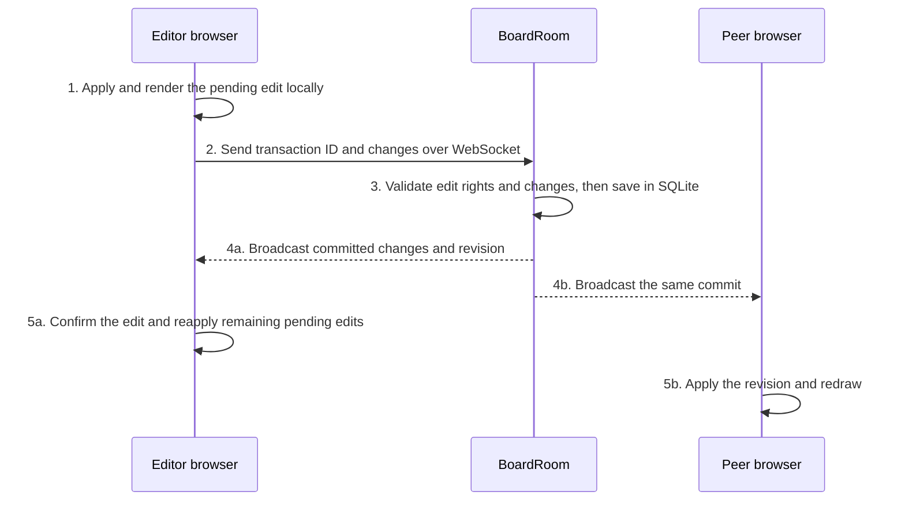
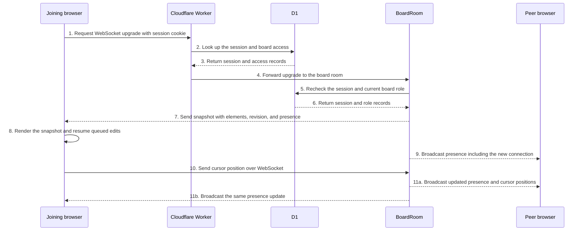

<p align="center">
  
</p>

<h1 align="center">Whiteboard</h1>

<p align="center"><strong>High performance multiplayer whiteboard.</strong></p>

<p align="center">
  Use it as a personal whiteboard or invite others to collaborate in real-time.
</p>

<p align="center">
  <a href="https://deploy.workers.cloudflare.com/?url=https://github.com/SkyIsTheLimit/whiteboard"></a>
</p>

<p align="center">
  <a href="#use-locally">Use Locally</a> · <a href="#deploy-to-cloudflare">Deploy to Cloudflare</a> · <a href="#how-it-works">How it works</a>
</p>


<a name="quick-start"></a>

## Use Locally

Use npm with Node.js 22.13+ on the 22.x line or Node.js 24 or newer.

```sh
npm ci
cp .dev.vars.example .dev.vars
```

Run `openssl rand -hex 32` and paste the output into `BETTER_AUTH_SECRET` in `.dev.vars`. Leave `BETTER_AUTH_URL` empty to use the local origin.

```sh
npm run db:migrate
npm run dev
```

Open the URL Vite prints and create an account. Wrangler keeps local D1 and Durable Object data in `.wrangler/state`.

<a name="how-to-use"></a>

Use **Select** to move or resize items, and Shift-click to select more than one. Draw shapes and text, link shapes with **Connector**, and double-click an item to edit its label. Pan with **Hand** or use the bottom-right controls to zoom or fit the board.

Board owners can use **Share** to invite viewers or editors. Invitees sign in to join. Revoking an invite stops new joins, and removing a member ends their access. To try collaboration locally, use two accounts in separate browser profiles.

## Deploy to Cloudflare

[](https://deploy.workers.cloudflare.com/?url=https://github.com/SkyIsTheLimit/whiteboard)

The button opens Cloudflare’s setup for cloning the repo, naming the Worker, and provisioning its resources. Use these values where prompted. [Cloudflare deploy button guide](https://developers.cloudflare.com/workers/platform/deploy-buttons/)

| Setup field               | Value                                                                                                                                    |
| ------------------------- | ---------------------------------------------------------------------------------------------------------------------------------------- |
| Worker name               | `whiteboard` is the repo default. Choose an available name in your account.                                                              |
| D1 database               | `whiteboard-test` is the repo default. You can choose another name. Keep the binding named `DB`.                                         |
| Build and deploy commands | The repo defines `npm run build` and `npm run deploy`. Keep `npm run deploy` as the deploy command so migrations run before publication. |
| `BETTER_AUTH_SECRET`      | Generate a fresh value with `openssl rand -hex 32`.                                                                                      |
| `BETTER_AUTH_URL`         | The public HTTPS origin, with no path, for example `https://whiteboard.example.com`.                                                     |

Cloudflare provisions the D1 database and the SQLite Durable Object binding `BOARD_ROOMS` from the Wrangler config. If the public origin is only available after deployment, set `BETTER_AUTH_URL` in the Worker’s **Variables and Secrets** and deploy that setting before signing in.

For a manual deployment, create a D1 database with `npx wrangler d1 create whiteboard-test` and add its ID to the `DB` entry in `wrangler.jsonc`. Keep the `BOARD_ROOMS` binding and SQLite class migration. Run `npm run deploy` and configure the two auth values in the Worker dashboard. The deploy script builds, applies pending migrations to the remote `DB` binding, and publishes only after migrations succeed.

For optional Google sign-in, set `GOOGLE_CLIENT_ID` and `GOOGLE_CLIENT_SECRET` and register `https://<your-host>/api/auth/callback/google` as the redirect URI.

## How it works

The TanStack Start and React client draws on Canvas 2D. A Cloudflare Worker serves the app and checks Better Auth sessions and board access in D1. Each board has a `BoardRoom` Durable Object with its own SQLite storage and hibernating WebSockets.

These C4 dynamic diagrams show interactions in order. Solid arrows show requests, messages, and local actions. Dashed arrows show responses and server broadcasts. The editor, joining browser, and peer are instances of the same Whiteboard browser client. [C4 dynamic diagrams](https://c4model.com/diagrams/dynamic)

### Apply an edit



If the room rejects an edit, the editor removes it from the pending queue, rebuilds the view from confirmed changes and remaining edits, and shows the reason.

### Join a board and sync with peers



Connected clients follow the room’s ordered commits. A client that detects a gap reconnects for a fresh snapshot.
