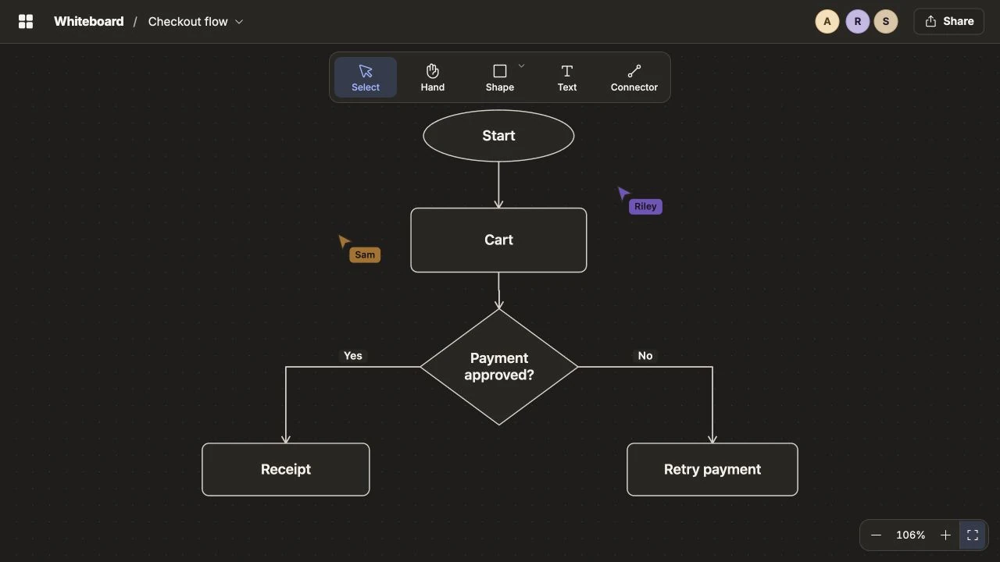
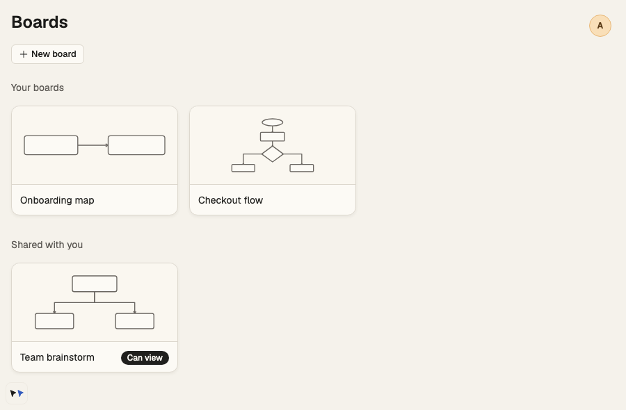
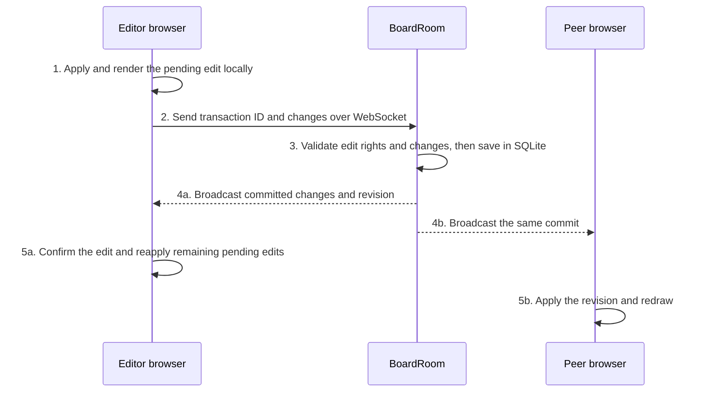
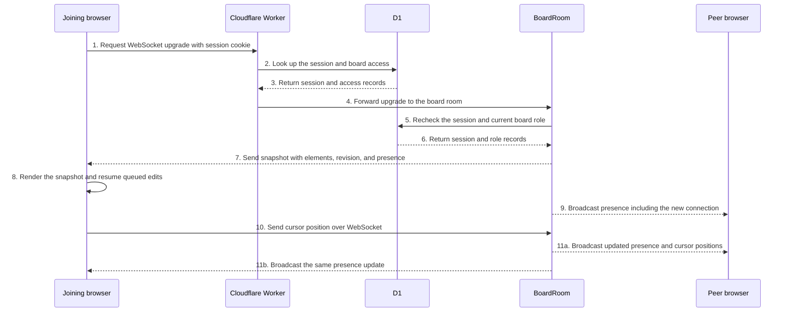

<p align="center">
  
</p>

<h1 align="center">Whiteboard</h1>

<p align="center"><strong>High performance multiplayer whiteboard.</strong></p>

<p align="center">
  Use it as a personal whiteboard or invite others to collaborate in real-time.
</p>

<p align="center">
  <a href="https://deploy.workers.cloudflare.com/?url=https://github.com/SkyIsTheLimit/whiteboard"></a>
</p>

<p align="center">
  <a href="#use-locally">Use Locally</a> · <a href="#deploy-to-cloudflare">Deploy to Cloudflare</a> · <a href="#how-it-works">How it works</a>
</p>





<a name="quick-start"></a>

## Use Locally

Use Node.js 22.13+ on the 22.x line, or Node.js 24 or newer.

```sh
npm ci
cp .dev.vars.example .dev.vars
```

Set `BETTER_AUTH_SECRET` in `.dev.vars` using `openssl rand -hex 32`. Leave `BETTER_AUTH_URL` empty locally.

```sh
npm run db:migrate
npm run dev
```

Open the URL Vite prints and create an account. Local data lives in `.wrangler/state`.

<a name="how-to-use"></a>

Draw or connect shapes, double-click to edit labels, and use **Hand** to pan.

Owners can use **Share** to invite viewers or editors and revoke access. Try it with two accounts in separate browser profiles.

## Deploy to Cloudflare

[](https://deploy.workers.cloudflare.com/?url=https://github.com/SkyIsTheLimit/whiteboard)

Click the button to deploy to Cloudflare. You’ll be asked for these values.

| Setup field               | Value                                                                                                                                    |
| ------------------------- | ---------------------------------------------------------------------------------------------------------------------------------------- |
| Worker name               | `whiteboard` is the repo default. Choose an available name in your account.                                                              |
| D1 database               | `whiteboard-test` is the repo default. You can choose another name. Keep the binding named `DB`.                                         |
| Build and deploy commands | The repo defines `npm run build` and `npm run deploy`. Keep `npm run deploy` as the deploy command so migrations run before publication. |
| `BETTER_AUTH_SECRET`      | Generate a fresh value with `openssl rand -hex 32`.                                                                                      |
| `BETTER_AUTH_URL`         | The public HTTPS origin, with no path, for example `https://whiteboard.example.com`.                                                     |

Cloudflare provisions D1 and `BOARD_ROOMS`. If you learn the public URL after deploying, set `BETTER_AUTH_URL` in **Variables and Secrets** and redeploy before signing in.

Deploying manually? Run `npx wrangler d1 create whiteboard-test`, add the ID to `DB` in `wrangler.jsonc`, and keep the `BOARD_ROOMS` binding and SQLite migration. Run `npm run deploy` to build, migrate D1, and publish. Set both auth values in the Worker dashboard.

For Google sign-in, set `GOOGLE_CLIENT_ID` and `GOOGLE_CLIENT_SECRET`, then register `https://<your-host>/api/auth/callback/google`.

## How it works

The React client draws on Canvas 2D. A Cloudflare Worker checks sessions and access in D1. Each board saves edits to SQLite and syncs over WebSockets in its own Durable Object.

Here’s how an edit works.

### Apply an edit



If the room rejects an edit, the client drops it, rebuilds the view, and shows why.

### Join a board and sync with peers



If a client misses a revision, it reconnects for a fresh snapshot.

Found a bug? [File an issue](https://github.com/SkyIsTheLimit/whiteboard/issues).
